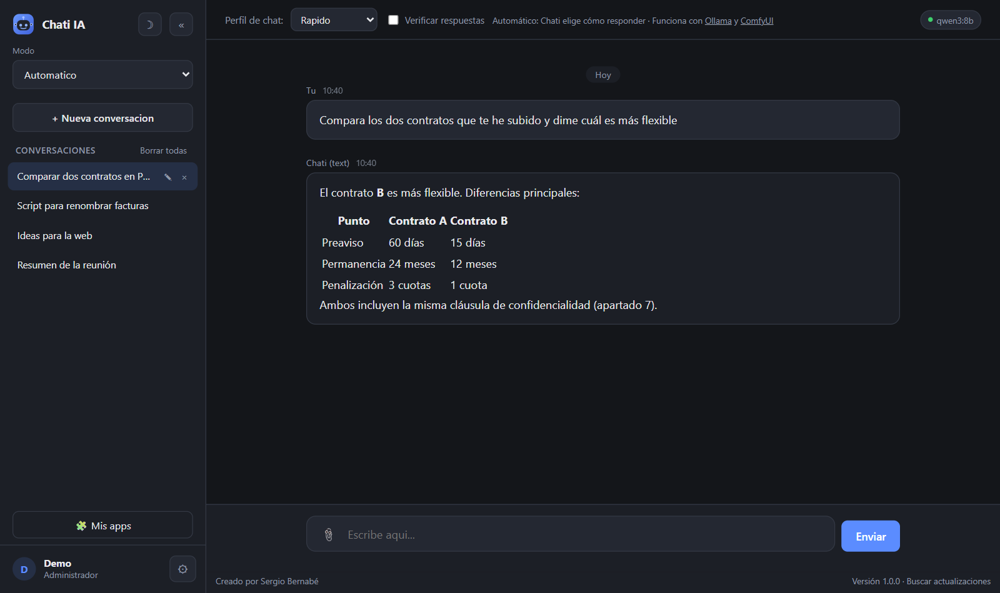

# Chati IA

Local AI assistant for Windows: chat, images, video, voice and a coding agent. Models run on your own computer with Ollama and ComfyUI.



## Download and install

### [⬇ Download Chati for Windows](https://github.com/Serberar/chati-ia/releases/latest/download/ChatiIA-Instalador.exe)

1. **Click the link above** and open `ChatiIA-Instalador.exe`.
2. If Windows says *"Windows protected your PC"*, click **More info** and then **Run anyway**. The app is not code-signed.
3. **Create your user and password.** They stay on your computer. Your conversations are encrypted with that password.
4. **Choose the models.** The basics are already selected (about 6 GB).
5. **Wait** for the downloads and open **Chati IA** from the desktop.

The installer and the app are in Spanish. Recommended: Windows 11, 32 GB of RAM and an NVIDIA card with 8 GB or more. It also runs without a graphics card, slowly.

If you already have Ollama or OpenCode, their settings and your models are left untouched. To uninstall: **Settings > Apps > Chati IA**.

## What it does

- **Chat** with local Ollama models, memory, documents (RAG), web search and deep search.
- **Images and short video** from text.
- **Voice:** transcription with faster-whisper and speech with Piper.
- **Coding agent** on top of OpenCode, with review, checkpoints and routines.
- **Accounts**, data encrypted at rest and push notifications.
- **Desktop app** (Windows tray) and installable mobile web app.

## Under the hood

- Each user has a data key, wrapped by another key derived from their password.
- A verifier checks answers so they do not make things up.
- The agent has guard rails: undo checkpoints, per-project rules and blocked dangerous commands.
- GPU management loads and unloads text, image and video models so they fit on one card.
- A content filter right before the generators refuses nudity and sexual content.

## Run it

```powershell
powershell -ExecutionPolicy Bypass -File setup/install.ps1
powershell -ExecutionPolicy Bypass -File setup/start_all.ps1
```

Then open `http://localhost:8899`. Models take tens of GB and are not in the repository.

## Tests

```powershell
cd orchestrator
python -m pytest -m "not live and not slow"
```

More details in the [Spanish README](README.md). [MIT](LICENSE) license.
