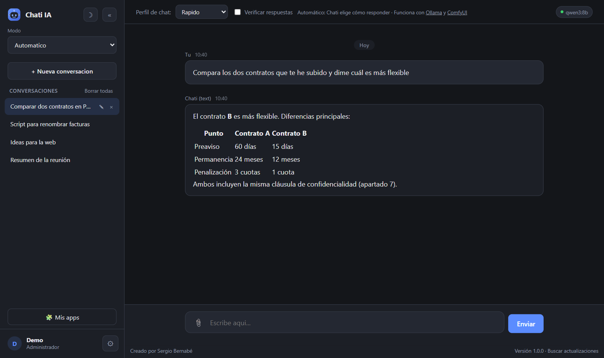

# Chati IA

**Español** · [English](README.en.md)

[](https://github.com/Serberar/chati-ia/actions/workflows/ci.yml)

Asistente de IA **local** para Windows: chat, imágenes, vídeo, voz y un agente de código. Los modelos se ejecutan en el propio equipo con Ollama y ComfyUI.



## Descargar e instalar

### [⬇ Descargar Chati para Windows](https://github.com/Serberar/chati-ia/releases/latest/download/ChatiIA-Instalador.exe)

1. **Pulsa el enlace de arriba.** Se descarga `ChatiIA-Instalador.exe` (mira en tu carpeta Descargas).
2. **Ábrelo con doble clic.** Si Windows dice *«Windows protegió su PC»*, pulsa **Más información** y luego **Ejecutar de todas formas**. Sale porque el programa no está firmado, que es un certificado de pago.
3. **Crea tu usuario y tu contraseña.** Son solo para tu ordenador. Apúntala: con ella se cifran tus conversaciones.
4. **Elige los modelos.** Lo básico ya viene marcado. Si no sabes cuál, no toques nada.
5. **Espera.** Descarga varios GB: según tu conexión, de unos minutos a un buen rato. No cierres la ventana.
6. **Abre «Chati IA»** desde el escritorio. Ya está.

### ¿Puede con él mi ordenador?

| | Lo mínimo | Lo recomendado |
|---|---|---|
| Windows | 10 u 11, de 64 bits | 11 |
| Memoria | 16 GB | 32 GB |
| Tarjeta gráfica | Ninguna (va, pero lento) | NVIDIA con 8 GB o más |
| Disco libre | 25 GB (lo marcado) | 80 GB (con todo) |

| Qué quieres | Ocupa |
|---|---|
| Chat, agente, memoria y voz (lo marcado) | Unos 6 GB |
| Comentar fotos | 6 GB más |
| Crear imágenes | 12 GB más, y ComfyUI |
| Vídeo corto | De 4,5 a 9,4 GB más, y ComfyUI |
| Modelo grande, modo Código | 18,6 GB más |

### Qué toca en tu ordenador

Instala lo que te falte: Python, Git, Ollama, Node.js y OpenCode. **Si ya tienes Ollama u OpenCode, no cambia su configuración ni tus modelos.** Solo se publica en Tailscale o arranca con Windows si lo marcas tú.

### Desinstalar

**Configuración > Aplicaciones > Chati IA > Desinstalar.** Te pregunta si quieres borrar también tus conversaciones y los modelos. Python, Git, Ollama, Node.js y OpenCode se quedan, por si los usas para otra cosa.

### Comprobar la descarga (opcional)

Junto al instalador se publica `ChatiIA-Instalador.exe.sha256`. En PowerShell, el resultado tiene que ser el mismo:

```powershell
Get-FileHash .\ChatiIA-Instalador.exe
```

## Qué incluye

- **Chat** con modelos locales de Ollama, memoria, documentos (RAG), búsqueda web y búsqueda profunda.
- **Imágenes** a partir de texto y ampliación.
- **Vídeo** corto a partir de texto, y películas por escenas.
- **Voz:** transcripción con faster-whisper y lectura con Piper.
- **Agente de código** sobre OpenCode, con revisión, puntos de control y rutinas.
- **Cuentas** de usuario, datos cifrados en reposo y avisos push.
- **App de escritorio** (bandeja de Windows) y web instalable en el móvil.

## Lo interesante por dentro

- **Modelos en local:** el chat, los documentos, las imágenes y la voz se procesan en el propio ordenador. Solo salen a internet las búsquedas web y los avisos push, si se usan.
- **Cifrado en reposo:** cada usuario tiene su clave de datos, cifrada con otra que sale de su contraseña.
- **Respuestas verificadas:** un verificador revisa las respuestas para que no inventen datos.
- **Agente de código con frenos:** puntos de control para deshacer, revisión, reglas por proyecto y bloqueo de órdenes peligrosas.
- **Gestión de la GPU:** carga y descarga modelos de texto, imagen y vídeo para que quepan en una sola tarjeta.
- **Filtro de contenido** en el último paso antes del generador ([content_guard.py](orchestrator/media/content_guard.py)): no se generan desnudos ni contenido sexual, se pida como se pida.

Los modelos se configuran en `orchestrator/config.yaml`.

## Servicios locales

| Servicio | Dirección |
|---|---|
| Chati (FastAPI) | `http://127.0.0.1:8899` |
| Ollama | `http://127.0.0.1:11434` |
| ComfyUI | `http://127.0.0.1:8188` |
| OpenCode | `http://127.0.0.1:8901` |

## Instalar desde el código

```powershell
powershell -ExecutionPolicy Bypass -File setup/install.ps1
```

Opciones: `-ConImagen no` (sin ComfyUI) y `-Tailscale si` (usarla desde el móvil). Los modelos ocupan decenas de GB y no están en el repositorio.

Los datos y modelos van a `%LOCALAPPDATA%/ChatiIA`; se cambia con `-DataRoot` o con la variable `CHATI_DATA_ROOT`.

## Arrancar y parar

```powershell
powershell -ExecutionPolicy Bypass -File setup/start_all.ps1
powershell -ExecutionPolicy Bypass -File setup/stop_chati.ps1
```

Después abre `http://localhost:8899`.

## Pruebas

```powershell
cd orchestrator
python -m pytest -m "not live and not slow"
```

`live` necesita Ollama y `slow` genera imagen o vídeo real con ComfyUI.

## Estructura

| Ruta | Qué es |
|---|---|
| `orchestrator/main.py` | Servidor FastAPI |
| `orchestrator/api/` | Rutas HTTP |
| `orchestrator/chat/` | Conversación, memoria, RAG y búsquedas |
| `orchestrator/coding/` | Agente de código |
| `orchestrator/agents/` | Clientes de Ollama y ComfyUI, e imagen, vídeo y voz |
| `orchestrator/media/` | Vídeo, archivos generados y filtro de contenido |
| `orchestrator/models/` | Catálogo, elección y memoria de los modelos |
| `orchestrator/accounts/` | Usuarios, sesiones, dispositivos y avisos |
| `orchestrator/infra/` | Rutas de datos, cifrado, métricas y registro |
| `orchestrator/static/` | Interfaz web |
| `orchestrator/workflows/` | Flujos de ComfyUI |
| `orchestrator/tests/` | Pruebas |
| `setup/` | Instalación, arranque, copias de seguridad y compilación |

## Copias de seguridad

```powershell
powershell -ExecutionPolicy Bypass -File setup/backup.ps1
powershell -ExecutionPolicy Bypass -File setup/restore.ps1
```

Por defecto las copias van a una carpeta de OneDrive y se conservan las 14 últimas; se cambia con `-Destino` y `-Mantener`.

## Publicar una versión

1. Sube `VERSION` en `orchestrator/version.py`.
2. Sube la etiqueta `vX.Y.Z`. GitHub pasa las pruebas, compila el instalador y crea la release en borrador con su huella.
3. Pruébala y publica el borrador.

En local: `setup/build_release.ps1` (necesita Inno Setup 6) deja el instalador en `setup/Output`.

## Licencia

[MIT](LICENSE)

## Autor

Sergio Bernabé
